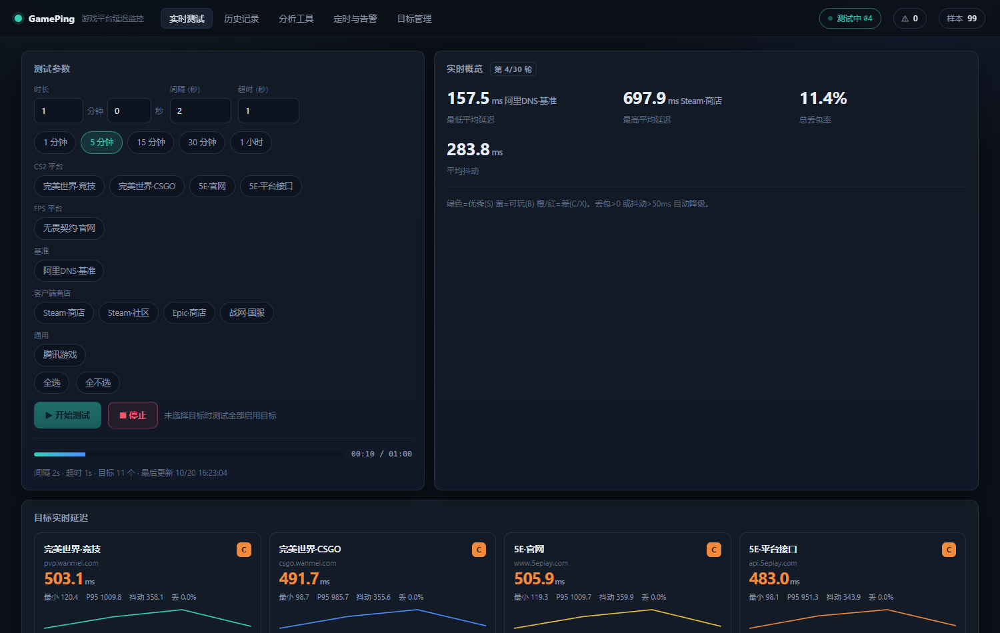
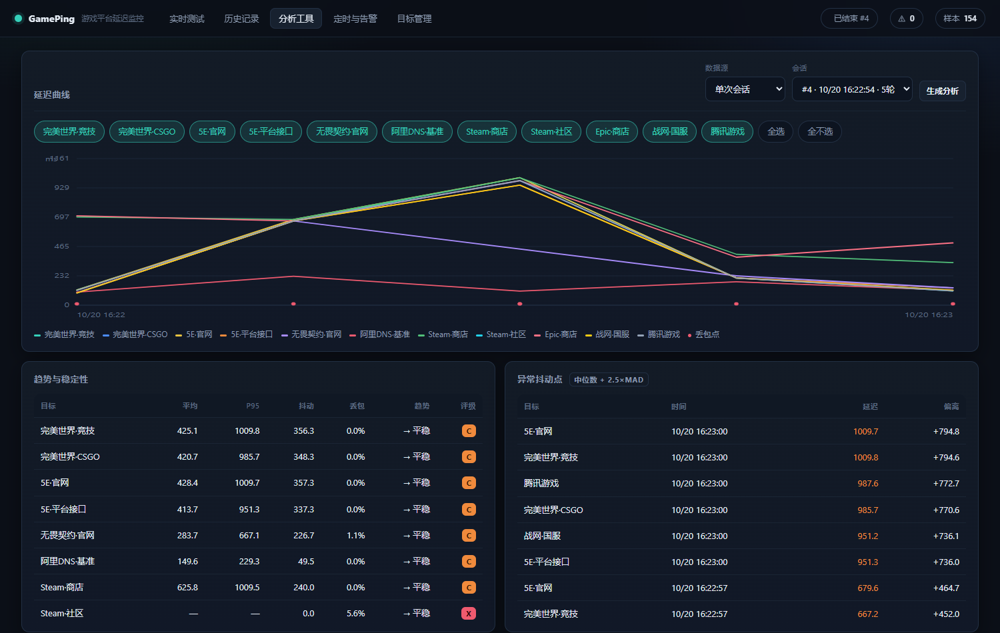
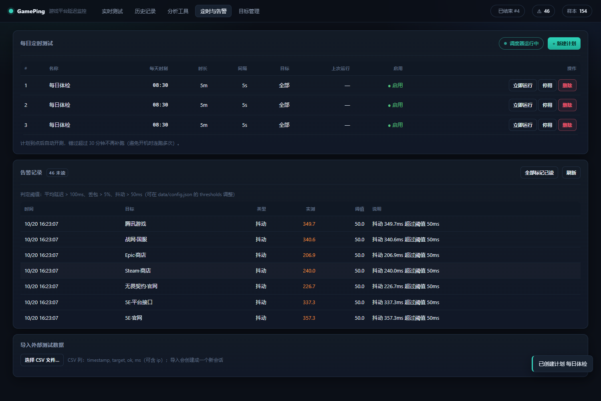

# GamePing · 游戏平台网络延迟监控

对各大游戏平台（完美世界、5E、无畏契约、Steam、Epic、战网 …）做**定时自动 ping 测试**，带 Web 界面、SQLite 历史存档、定时执行、阈值告警与分析工具。

[English](README.md)



## 功能

- **四种探测方式** — `tcp`（TCP 三次握手，默认）、`icmp`（系统 ping）、`dns`（无缓存解析耗时）、`http`（HEAD 首字节 TTFB）。默认用 TCP，因为对任何 HTTPS 端口都可用，也不受服务器禁 ping 影响。
- **实时面板** — 每个目标的平均/最小/P95/抖动/丢包、走势小图、S~X 评级，外加全局最优/最差/丢包/抖动指标与进度条。
- **SQLite 历史** — 每轮样本全部入库，会话跨重启保留，界面启动时自动接上最后一次结果。
- **定时执行** — 可设「每天 HH:MM 跑 N 分钟」，后台调度线程自动开测。错过超过 30 分钟宽限窗口**不补跑**（笔记本 09:00 开机不该连跑六次）。
- **阈值告警** — 每次会话结束按延迟/丢包/抖动阈值判定，超标的落库并在顶部显示未读角标。
- **分析工具** — 延迟曲线（单会话或任意时间窗，多目标叠加）、趋势（前 1/3 对比后 1/3）、基于 MAD 的异常抖动点、两目标综合评分对比、按天跨会话趋势、按小时/星期的丢包热力图。
- **链路标注与对比** — 给会话填一条网络备注（如「有线」「手机热点」），分析页就能按两条链路逐目标并排对比。
- **自包含 HTML 报告** — 单文件、内联 SVG、无任何外部资源，可以直接发给朋友。
- **导入** — 支持外部 CSV/JSON 样本，未匹配的目标会自动创建。
- **导出** — 单会话 CSV（带 BOM，Excel 双击不乱码）与 JSON；支持按天数清理旧数据。
- **前端零依赖零构建** — 一个 HTML、一个 CSS、一个 JS，和 FastAPI 同进程。



## 快速开始

```bash
pip install -r requirements.txt          # 只依赖 fastapi + uvicorn

python -m gameping serve                # http://127.0.0.1:8848
python -m gameping serve --port 9000    # 换端口
```

项目根目录也可以直接 `python run.py`。

## 命令行

```bash
gameping test -t 60 -i 5                 # 60 秒无界面跑一轮，写入同一个库
gameping test -n 10 --targets 5E·官网    # 10 轮，只测一个目标
gameping analyze --days 30               # 跨会话趋势表，不用起网页
gameping report -s 12 -o out.html        # 导出自包含 HTML 报告
```

## 界面说明

| 页面 | 用途 |
| --- | --- |
| 实时测试 | 选时长/间隔/目标，开始与停止，看实时卡片 |
| 历史记录 | 会话列表、单会话汇总、CSV/JSON/HTML 导出、删除 |
| 分析工具 | 曲线、趋势、抖动点、热力图、跨会话趋势、A/B 对比 |
| 定时与告警 | 每日计划、告警记录、CSV 导入 |
| 目标管理 | 增删改查、启停、单次探测、解析 IP、探测方式 |



## 接口一览

| 方法 | 路径 | 说明 |
| --- | --- | --- |
| GET | `/api/health` | 健康检查 |
| GET | `/api/targets?all=1` | 目标列表（含解析 IP） |
| POST | `/api/targets` | 新增 `{name,host,port,proto,group}` |
| PATCH | `/api/targets/{id}` | 局部更新 |
| DELETE | `/api/targets/{id}` | 删除目标及其样本 |
| POST | `/api/targets/{id}/probe` | 立即探测一次 |
| POST | `/api/session/start` | `{duration,interval,timeout,rounds,target_ids}` |
| POST | `/api/session/stop` | 停止当前会话 |
| GET | `/api/session/live` | 实时状态 + 各目标统计 |
| GET | `/api/sessions` | 历史列表 |
| GET | `/api/sessions/{id}` | 会话详情 + 汇总 |
| GET | `/api/sessions/{id}/series` | 分桶曲线、趋势、抖动点 |
| GET | `/api/sessions/{id}/compare?a=&b=` | 两目标对比 |
| GET | `/api/sessions/{id}/export.csv\|json` | 下载 |
| GET | `/api/sessions/{id}/report.html` | 自包含报告（`?download=1` 直接下载） |
| DELETE | `/api/sessions/{id}` | 删除会话 |
| POST | `/api/sessions/import` | 导入 JSON 样本 |
| POST | `/api/sessions/import.csv` | 导入 CSV（原始 body，`text/csv`） |
| GET | `/api/analytics/trends?days=N` | 按天跨会话趋势 |
| GET | `/api/analytics/heatmap?days=N&bucket=hour\|dow` | 丢包热力图 |
| GET | `/api/analytics/window?start=&end=&target_ids=` | 任意时间窗 |
| GET | `/api/analytics/notes` | 会话备注（链路）列表 |
| GET | `/api/analytics/notes/compare?a=&b=` | 两条链路对比 |
| GET/POST | `/api/schedules` | 查看 / 新建每日计划 |
| PATCH/DELETE | `/api/schedules/{id}` | 修改 / 删除计划 |
| POST | `/api/schedules/{id}/run` | 立即运行计划 |
| GET | `/api/alerts` | 告警列表 + 未读数 + 阈值 |
| POST | `/api/alerts/seen` | 标记已读（全部，或按 `alert_id`） |
| POST | `/api/alerts/check/{session_id}` | 重新判定某个会话 |
| POST | `/api/maintenance/purge?days=N` | 按保留期清理 |
| GET | `/api/stats/overview` | 数据库统计 |

自动生成的可交互文档：`http://127.0.0.1:8848/docs`。

## 目录结构

```
gameping/
├── run.py                    # 便捷启动器
├── requirements.txt
├── pyproject.toml
├── src/gameping/
│   ├── config.py             # 路径、默认参数、内置目标、告警阈值
│   ├── probe.py              # tcp / icmp / dns / http 四种探测、DNS 缓存
│   ├── stats.py              # 纯统计：百分位、评级、分桶、趋势、抖动点
│   ├── db.py                 # SQLite 表结构与 DAO（target/session/sample/schedule/alert）
│   ├── runner.py             # 后台会话循环、实时增量聚合
│   ├── scheduler.py          # 每日 HH:MM 调度线程
│   ├── alerts.py             # 阈值判定
│   ├── report.py             # 自包含 HTML 报告
│   ├── api.py                # FastAPI 路由 + 静态托管
│   ├── cli.py                # serve / test / analyze / report
│   └── web/                  # index.html · style.css · app.js · favicon.svg
├── tests/                    # 69 个 pytest 用例
├── .verify/                  # Playwright 界面冒烟脚本（不随包发布）
└── data/                     # SQLite 与配置（已在 .gitignore）
```

## 评级规则

| 评级 | 平均延迟 | 体感 |
| --- | --- | --- |
| S | ≤ 40 ms | 竞技 FPS 很理想 |
| A | ≤ 70 ms | 良好 |
| B | ≤ 110 ms | 可玩 |
| C | > 110 ms | 明显卡顿 |
| X | — | 全部探测失败 |

有任何丢包降一级；丢包 ≥ 25% 封顶 C；≥ 50% 直接 X；抖动 > 50ms 也降一级。

## 配置

首次运行生成 `data/config.json`，也可通过 `PATCH /api/config` 修改：

```json
{
  "interval": 5.0,
  "timeout": 1.0,
  "retention_days": 90,
  "max_workers": 16,
  "thresholds": { "latency": 100.0, "loss": 5.0, "jitter": 50.0 }
}
```

环境变量 `GAMEPING_DATA_DIR` 可以换数据目录。

## 测试

```bash
pip install pytest
PYTHONPATH=src python -m pytest -q     # 69 passed
```

界面冒烟（可选，需要本机 Chrome）：

```bash
cd .verify && npm i && node verify.js  # 截图落到 .verify/shots/
```

## 注意事项

- **测出来的基线取决于你当时走哪条链路。** 有线、Wi-Fi、手机热点三者差异很大：同一批目标在有线光纤下 45–70ms，换成手机热点常见 150–250ms。建议每次测试都填一条链路备注，这样才是同口径对比。
- **并发会抬高实测延迟。** 十几个目标同时建连会抢同一个 socket 预算，多目标一轮的读数比单独 `ping` 高。要绝对数值就少测几个目标。
- TCP 探测测的是到**边缘节点/CDN** 的握手 RTT，不等于游戏内对局服务器延迟；要测对局服需换成区域服地址。
- `steamcommunity.com` 在默认网络环境下本就不通，会显示 X / 100% 丢包，属正常现象而非 bug。
- ICMP 模式是调用系统 `ping`，需要相应权限。
- 各平台会轮换 CDN 域名，请在「目标管理」页确认解析 IP 是否合理。
